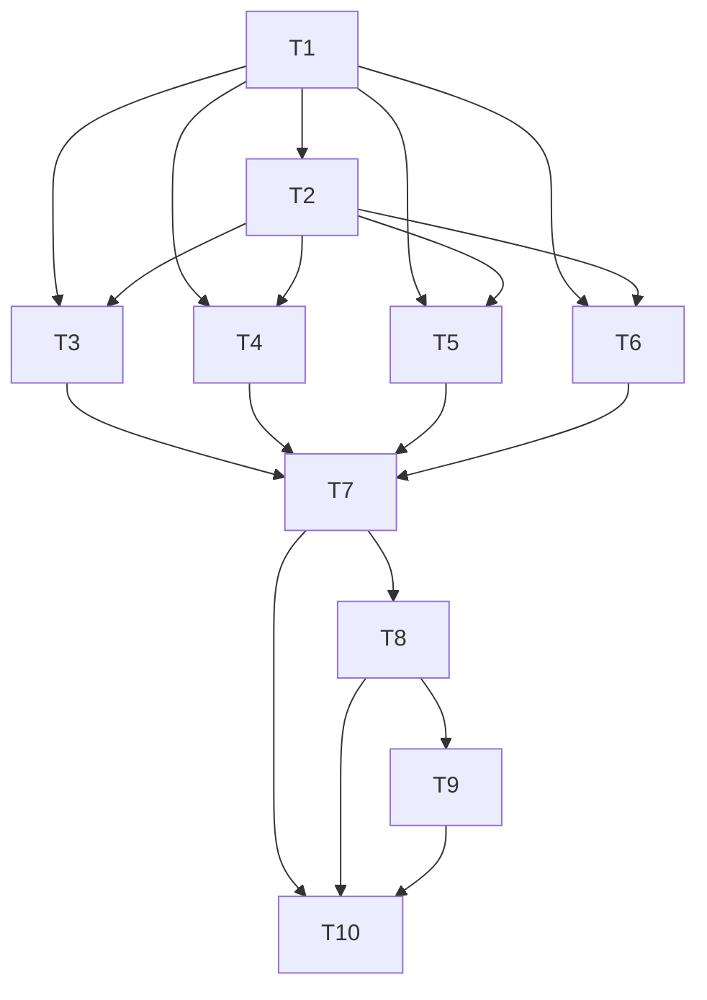

# Tasks — Spec 003: Página «Reservar»

> **Formato**: Una tarea = unidad atómica verificable. Test-first: criterios de prueba **antes** de cambios de código.
> **Verificación**: MCP Playwright (login `gguzman`/`123456`) + `npm run typecheck` + `npm run lint` + `npm run build`.
> **Dependencias**: Formato `[Depende de: TX, TY]` o `[Depende de: Ninguna]`.
> **Paralelizable**: `true` si puede ejecutarse simultáneamente con otra tarea del mismo grupo.

---

## T1 — Helpers puros: `reserva-calculos.ts` y `showtime-format.ts`

| Campo | Detalle |
|-------|---------|
| **Título** | Crear helpers puros de cálculo de totales y formateo de showtimes |
| **Descripción** | Crear dos archivos en `src/lib/`:<br>1. `reserva-calculos.ts` con funciones puras:<br>   - `calcularTotal(elegidos: number[], price: number): number` → `elegidos.length * price`<br>   - `redondearTotal(total: number): number` → `Math.round(total * 100) / 100` (2 decimales)<br>2. `showtime-format.ts` con funciones puras (reciben `Date` o strings, **no leen reloj interno**):<br>   - `formatearShowtime(date: string, startTime: string): string` → ej. «Lun 20 Oct, 19:30» (locale ES, hora local)<br>   - `formatearFecha(date: string): string` → ej. «Lunes 20 de Octubre»<br>   - Usar `Intl.DateTimeFormat('es-ES', ...)` con componentes locales. |
| **Archivos** | `src/lib/reserva-calculos.ts` (nuevo)<br>`src/lib/showtime-format.ts` (nuevo) |
| **RF Cubiertos** | RF-18 (total en resumen), RF-09 (precio en showtime), RNF-02 (accesibilidad fechas), RNF-06 (i18n prep) |
| **Criterios de Prueba** | 1. `npm run typecheck` → 0 errores en nuevos archivos<br>2. `npm run lint` → 0 warnings<br>3. Verificar en consola del navegador (Playwright `page.evaluate`):<br>   - `calcularTotal([1,2,3], 50) === 150`<br>   - `redondearTotal(100.555) === 100.56`<br>   - `formatearShowtime('2026-10-20', '19:30:00')` contiene «20 Oct» y «19:30»<br>   - `formatearFecha('2026-10-20')` contiene «Lunes» y «Octubre» |
| **Dependencias** | `[Depende de: Ninguna]` |
| **Paralelizable** | `true` |

---

## T2 — Hooks base: `useMovieWithShowtimes` y `useSeatSelection`

| Campo | Detalle |
|-------|---------|
| **Título** | Extraer hooks reutilizables de `PeliculasDellatePage` y `FuncionAsientosPage` |
| **Descripción** | Crear dos hooks en `src/hooks/`:<br>1. `useMovieWithShowtimes(movieId: number)` → `{ pelicula, funciones, cargando, error, recargar }`<br>   - Usa `peliculaService.obtenerPelicula(movieId)` + `carteleraService.listarFunciones(movieId)` en `Promise.all`<br>   - Filtra `funciones` a `status === 'PROGRAMADA'`<br>   - Expone `recargar()` para refrescar silencioso (útil tras 409)<br>2. `useSeatSelection(showtimeId: number)` → `{ asientos, porFila, elegidos, alternar, limpiar, cargando, error, recargar, funcion }`<br>   - Extrae lógica completa de `FuncionAsientosPage`: carga asientos con `carteleraService.asientosDeFuncion(showtimeId)`, agrupa por `row`, ordena por `number`<br>   - Estado `elegidos: number[]` + `alternar(id)`, `limpiar()`<br>   - Derivados: `total` (usa `calcularTotal` de T1), `nombresElegidos` (formato «Fila N°»)<br>   - `recargar()` vuelve a llamar `asientosDeFuncion` (para 409) |
| **Archivos** | `src/hooks/useMovieWithShowtimes.ts` (nuevo)<br>`src/hooks/useSeatSelection.ts` (nuevo) |
| **RF Cubiertos** | RF-01, RF-05 (carga película+funciones), RF-08..RF-12 (showtimes), RF-13..RF-17 (asientos), RF-21 (recarga silenciosa 409) |
| **Criterios de Prueba** | 1. `typecheck` + `lint` + `build` en verde<br>2. Playwright: Login → `/reservar/1` → Verificar que `useMovieWithShowtimes` carga película y funciones (Paso 1 renderiza tarjetas)<br>3. Playwright: En Paso 2, verificar `useSeatSelection`:<br>   - Mapa renderiza filas ordenadas, butacas con número<br>   - Clic en butaca libre → `elegidos` aumenta, badge actualiza<br>   - Clic en butaca elegida → `elegidos` disminuye<br>   - Butaca `available=false` → deshabilitada, no clicable<br>4. Playwright: Teclado en mapa (C-12): Tab → primer asiento libre, Enter → selecciona, Flecha derecha → siguiente |
| **Dependencias** | `[Depende de: T1]` (usa `calcularTotal`, `formatearShowtime`) |
| **Paralelizable** | `true` (independiente de T1 en archivo, pero lógica depende de helpers) |

---

## T3 — Componente `MovieSelector` (Paso 0)

| Campo | Detalle |
|-------|---------|
| **Título** | Selector de película para `/reservar` (Paso 0) |
| **Descripción** | Componente `src/components/reserva/MovieSelector.tsx`:<br>- Recibe `onSelect: (movieId: number) => void`<br>- Usa `peliculaService.listarPeliculas()` (paginado simple, page=1, perPage=50)<br>- Para cada película, llama `carteleraService.listarFunciones(movieId)` y cuenta `status === 'PROGRAMADA'`<br>- Renderiza grid responsivo (Metronic/Tailwind): tarjeta con poster, título, badge «X funciones disponibles»<br>- Si 0 funciones → tarjeta deshabilitada o no se muestra<br>- Si 0 películas con funciones → mensaje «No hay películas con funciones disponibles» + enlace «Volver al catálogo» (`/peliculas`)<br>- Loading skeleton y manejo de error |
| **Archivos** | `src/components/reserva/MovieSelector.tsx` (nuevo) |
| **RF Cubiertos** | RF-01, RF-02, RF-03, RF-04 |
| **Criterios de Prueba** | 1. `typecheck` + `lint` + `build` en verde<br>2. Playwright (C-01): Login → `/reservar` → Verificar grid de películas con badge «X funciones disponibles»<br>3. Playwright (C-04): Clic en primera película → avanza a Paso 1 (showtimes de esa película)<br>4. Playwright: Si no hay películas con funciones → mensaje + enlace «Volver al catálogo» navega a `/peliculas` |
| **Dependencias** | `[Depende de: T1, T2]` (usa helpers formato, pero principalmente servicios directos) |
| **Paralelizable** | `true` (puede desarrollarse en paralelo con T4) |

---

## T4 — Componente `ShowtimeSelector` (Paso 1)

| Campo | Detalle |
|-------|---------|
| **Título** | Selector de showtime agrupado por fecha (Paso 1) |
| **Descripción** | Componente `src/components/reserva/ShowtimeSelector.tsx`:<br>- Recibe `movieId: number`, `onSelect: (showtimeId: number) => void`, `onBack?: () => void` (para «Cambiar película» en `/reservar`)<br>- Usa `useMovieWithShowtimes(movieId)` (T2)<br>- Agrupa `funciones` por `date` (string `YYYY-MM-DD`), ordena grupos por fecha asc, dentro de cada grupo ordena por `startTime` asc<br>- Renderiza secciones por día: encabezado con `formatearFecha(date)` (T1), tarjetas de función<br>- Tarjeta muestra: `startTime` (HH:mm), `room` + `roomType`, `price` (Bs), badge «Completa» si 0 asientos disponibles (requiere carga adicional o estimación)<br>- Tarjeta «Completa» → `disabled`, estilo muted<br>- Clic en tarjeta válida → `onSelect(showtimeId)`<br>- Botón «Cambiar película» visible solo si `onBack` provisto (ruta `/reservar`) |
| **Archivos** | `src/components/reserva/ShowtimeSelector.tsx` (nuevo) |
| **RF Cubiertos** | RF-05, RF-06, RF-08, RF-09, RF-10, RF-11, RF-12, RF-24 |
| **Criterios de Prueba** | 1. `typecheck` + `lint` + `build` en verde<br>2. Playwright (C-02): Login → `/reservar/1` → Verificar Paso 1 renderiza showtimes agrupados por fecha, ordenados por hora<br>3. Playwright (C-05): Verificar visual: encabezados de fecha, tarjetas en orden horario<br>4. Playwright (C-06): Clic en primera función → avanza a Paso 2 (mapa de asientos carga)<br>5. Playwright: Función sin asientos → badge «Completa», no clicable<br>6. Playwright (C-14): En `/reservar` (Paso 1), botón «Cambiar película» → vuelve a Paso 0 |
| **Dependencias** | `[Depende de: T1, T2]` |
| **Paralelizable** | `true` (puede desarrollarse en paralelo con T3) |

---

## T5 — Componente `SeatMap` + integración `useSeatSelection` (Paso 2)

| Campo | Detalle |
|-------|---------|
| **Título** | Mapa de asientos reutilizable con accesibilidad y responsive |
| **Descripción** | Componente `src/components/reserva/SeatMap.tsx`:<br>- Recibe `showtimeId: number`, `onContinue: () => void`, `onBack: () => void`<br>- Usa `useSeatSelection(showtimeId)` (T2)<br>- Renderiza igual que `FuncionAsientosPage`: div «Pantalla», filas (`porFila`), cada fila con botones de butaca<br>- **Estados visuales**: Libre (secondary), Elegido (primary), Ocupado (muted, disabled)<br>- **Accesibilidad (RNF-02, C-12)**:<br>   - Cada `<button>`: `aria-label="Fila {row}, Butaca {number}"`<br>   - `tabIndex=0` en botones habilitados<br>   - `onKeyDown`: ArrowRight/Left → foco siguiente/anterior butaca libre; Enter/Space → `alternar(id)`<br>- **Responsive (RNF-03, C-13)**: Contenedor `overflow-x-auto` en filas; en móvil (`<md`) scroll horizontal por fila<br>- Leyenda: Libre / Elegido / Ocupado<br>- Botón «Continuar al resumen» habilitado si `elegidos.length > 0` → `onContinue()`<br>- Botón «Cambiar función» → `onBack()` |
| **Archivos** | `src/components/reserva/SeatMap.tsx` (nuevo) |
| **RF Cubiertos** | RF-13, RF-14, RF-15, RF-16, RF-17, RF-23 (parte), RNF-02, RNF-03 |
| **Criterios de Prueba** | 1. `typecheck` + `lint` + `build` en verde<br>2. Playwright (C-06): Desde Paso 1, clic función → Paso 2 renderiza mapa completo<br>3. Playwright (C-07): Clic 2 asientos libres → badge «2 butacas», total = 2 × precio<br>3. Playwright (C-08): Seleccionar asiento → «Cambiar función» → Paso 1 → elegir otra función → verificar `elegidos = []` (mapa limpio)<br>4. Playwright (C-12): Teclado — Tab a primer asiento libre, Enter selecciona, Flecha derecha mueve foco<br>5. Playwright (C-13): `page.setViewportSize({width: 375, height: 667})` → scroll horizontal en filas, leyenda visible |
| **Dependencias** | `[Depende de: T1, T2]` |
| **Paralelizable** | `true` (puede desarrollarse en paralelo con T6) |

---

## T6 — Componentes `ReservaResumen` y `ReservaExito` (Paso 3)

| Campo | Detalle |
|-------|---------|
| **Título** | Panel de resumen/confirmación y pantalla de éxito (sin modal) |
| **Descripción** | Dos componentes en `src/components/reserva/`:<br>1. `ReservaResumen.tsx`:<br>   - Recibe `funcion: Funcion`, `elegidos: number[]`, `asientos: Asiento[]`, `onConfirm: () => void`, `onBack: () => void`<br>   - Usa `calcularTotal`, `redondearTotal` (T1), `formatearShowtime` (T1)<br>   - Muestra: Título película, `formatearShowtime(date, startTime)`, `room` + `roomType`, lista asientos «Fila N°», precio unitario, **total redondeado**<br>   - Botón «Confirmar reserva» → `onConfirm()`<br>   - Botón «Cambiar función» → `onBack()`<br>   - **Responsive**: En móvil (`<md`), panel colapsable en `Sheet` (Radix) con trigger «Ver resumen»<br>2. `ReservaExito.tsx`:<br>   - Recibe `reservationCode: string`, `onVolver: () => void`<br>   - Pantalla centrada (no modal): ícono check, texto «¡Reserva confirmada!», código grande `RES-...`, botón «Volver al catálogo» → `onVolver()` (navega a `/peliculas`)<br>   - Usa `history.replace` para evitar «Atrás» al formulario (caso límite spec) |
| **Archivos** | `src/components/reserva/ReservaResumen.tsx` (nuevo)<br>`src/components/reserva/ReservaExito.tsx` (nuevo) |
| **RF Cubiertos** | RF-18, RF-19, RF-20, RF-21, RF-22, RF-23 (parte), D-05 (sin modal) |
| **Criterios de Prueba** | 1. `typecheck` + `lint` + `build` en verde<br>2. Playwright (C-09): Seleccionar asientos → «Continuar» → Paso 3 muestra todos los campos correctos<br>3. Playwright (C-10): Clic «Confirmar reserva» → muestra `ReservaExito` con `reservationCode` formato `RES-{showtimeId}-{base36}`, botón «Volver al catálogo» → `/peliculas`<br>4. Playwright (C-11): **Setup**: crear reserva previa ocupando asientos X,Y (script o manual). En nuevo flujo, seleccionar X,Y → confirmar → verificar *toast* (sonner) «Algunos asientos ya no están disponibles», vuelta a Paso 2, mapa recargado con X,Y marcados «Ocupado»<br>5. Playwright: Error genérico (simular fallo red) → mensaje «No se pudo completar la reserva» + botón «Reintentar» en Paso 3 |
| **Dependencias** | `[Depende de: T1, T2, T5]` (necesita `SeatMap` para flujo completo) |
| **Paralelizable** | `true` (puede desarrollarse en paralelo con T5) |

---

## T7 — Hook `useReservaStepper` + `ReservarPage` (Orquestación principal)

| Campo | Detalle |
|-------|---------|
| **Título** | Hook de orquestación del stepper y página principal `ReservarPage` |
| **Descripción** | 1. `src/hooks/useReservaStepper.ts`:<br>   - Estado: `step: 0|1|2|3`, `movieId?: number`, `showtimeId?: number`, `funcion?: Funcion`, `elegidos: number[]`, `reservationCode?: string`<br>   - Acciones: `goToStep(n)`, `next()`, `back()`, `selectMovie(id)`, `selectShowtime(id, funcion)`, `selectSeats(ids)`, `confirm(reservationCode)`, `reset()`<br>   - Reglas: `next()` valida paso actual (Paso 0: movieId; Paso 1: showtimeId; Paso 2: elegidos.length>0); `selectShowtime` limpia `elegidos`; `back()` desde Paso 1 en `/reservar` va a Paso 0, en `/reservar/:movieId` no hace nada o va a catálogo<br>   - Expone `canGoNext` computado<br>2. `src/pages/ReservarPage.tsx`:<br>   - Lee `movieId` de `useParams` (ruta `/reservar/:movieId`)<br>   - Inicializa stepper: si `movieId` → step=1 y `selectMovie(movieId)`; si no → step=0<br>   - Renderiza paso actual: `<MovieSelector />`, `<ShowtimeSelector />`, `<SeatMap />`, `<ReservaResumen />` o `<ReservaExito />`<br>   - Pasa callbacks al stepper<br>   - Maneja error 409 en confirmación: `catch (e) if HttpError.status===409 → toast + stepper.backToStep(2) + seatMap.recargar()` |
| **Archivos** | `src/hooks/useReservaStepper.ts` (nuevo)<br>`src/pages/ReservarPage.tsx` (nuevo) |
| **RF Cubiertos** | RF-03, RF-07, RF-11, RF-12, RF-19..RF-25 (navegación, confirmación, 409, recarga) |
| **Criterios de Prueba** | 1. `typecheck` + `lint` + `build` en verde<br>2. Playwright (C-03): Sin login → `/reservar` → redirect `/auth/signin?next=/reservar` (RequireAuth)<br>3. Playwright (C-14): Navegación completa: Paso 0→1→2→3→éxito; botones «Cambiar función»/«Volver»/«Cambiar película» funcionan<br>4. Playwright (C-15): En Paso 2, `page.reload()` → vuelve a Paso 0 (`/reservar`) o Paso 1 (`/reservar/:movieId`)<br>5. Playwright (C-11): Flujo 409 integrado (ver T6 C-11)<br>6. Playwright: Sesión expira (borrar `cine_token` en medio) → confirmar → redirect login con `next` conservado |
| **Dependencias** | `[Depende de: T3, T4, T5, T6]` |
| **Paralelizable** | `false` (requiere todos los componentes de pasos) |

---

## T8 — Rutas en `app-routing-setup.tsx` + `RequireAuth`

| Campo | Detalle |
|-------|---------|
| **Título** | Registrar rutas `/reservar` y `/reservar/:movieId` protegidas |
| **Descripción** | Modificar `src/routing/app-routing-setup.tsx`:<br>- Importar `ReservarPage` desde `@/pages/ReservarPage`<br>- Dentro de `<Route element={<RequireAuth />}> > <Route element={<Demo1Layout />}>`, añadir:<br>  ```tsx<br>  <Route path="/reservar" element={<ReservarPage />} /><br>  <Route path="/reservar/:movieId" element={<ReservarPage />} /><br>  ```<br>- **No** usar `RequireRole` — cualquier autenticado (CLIENT, ADMIN, MANAGER) accede (backend valida roles en POST)<br>- Verificar que `RequireAuth` redirige a `/auth/signin?next=...` conservando ruta completa |
| **Archivos** | `src/routing/app-routing-setup.tsx` (modificar) |
| **RF Cubiertos** | RF-05, RF-07, RNF-04 |
| **Criterios de Prueba** | 1. `typecheck` + `lint` + `build` en verde<br>2. Playwright (C-01): Login → `/reservar` → renderiza Paso 0<br>3. Playwright (C-02): Login → `/reservar/1` → renderiza Paso 1 directamente<br>4. Playwright (C-03): Sin login → `/reservar` → redirect `/auth/signin?next=/reservar`; igual para `/reservar/1` |
| **Dependencias** | `[Depende de: T7]` (necesita `ReservarPage` creado) |
| **Paralelizable** | `false` (depende de T7) |

---

## T9 — Mejora UX: Enlace desde `PeliculasDellatePage` a `/reservar/:movieId` (Opcional)

| Campo | Detalle |
|-------|---------|
| **Título** | Añadir CTA «Reservar» en detalle de película para entrar directo al flujo |
| **Descripción** | Modificar `src/pages/peliculas/peliculas-detalle-page.tsx`:<br>- Añadir botón «Reservar entradas» prominente (ej. en cabecera o al final de horarios)<br>- `onClick` → `navigate(\`/reservar/${idPelicula}\`)`<br>- Solo visible si hay funciones programadas (`funciones.length > 0`)<br>- Mejora UX: evita que usuario deba copiar ID de función manualmente |
| **Archivos** | `src/pages/peliculas/peliculas-detalle-page.tsx` (modificar) |
| **RF Cubiertos** | Mejora UX (no RF explícito, pero apoya HU-01) |
| **Criterios de Prueba** | 1. `typecheck` + `lint` + `build` en verde<br>2. Playwright: Login → `/peliculas/1` → Verificar botón «Reservar entradas» visible<br>3. Playwright: Clic botón → navega a `/reservar/1` → muestra Paso 1 con showtimes de esa película |
| **Dependencias** | `[Depende de: T8]` (rutas deben existir) |
| **Paralelizable** | `true` (puede hacerse en paralelo con T10) |

---

## T10 — Verificación final completa (C-01..C-16)

| Campo | Detalle |
|-------|---------|
| **Título** | Ejecución completa de criterios de aceptación + CI |
| **Descripción** | Ejecutar suite completa de verificación:<br>1. `npm run typecheck` → exit 0<br>2. `npm run lint` → exit 0 (ignorar errores pre-existing de `field` si los hay)<br>3. `npm run build` → exit 0<br>4. Playwright MCP: Ejecutar todos los criterios C-01 a C-16 de la spec en orden<br>5. Actualizar `MEMORY.md` con resumen de cambios, decisiones y criterios verificados |
| **Archivos** | `MEMORY.md` (actualizar)<br>Ningún archivo de código nuevo |
| **RF Cubiertos** | Todos (validación end-to-end) |
| **Criterios de Prueba** | 1. Todos los comandos CI en verde<br>2. Playwright: C-01 a C-16 todos pasan (ver spec tabla §12)<br>3. `MEMORY.md` actualizado con entrada dated |
| **Dependencias** | `[Depende de: T7, T8, T9]` |
| **Paralelizable** | `false` (tarea final obligatoria) |

---

## Resumen de Dependencias (DAG)



## Grupos de Paralelismo

| Fase | Tareas | Notas |
|------|--------|-------|
| **Fase 1: Fundación** | T1, T2 | Independientes, empezar aquí |
| **Fase 2: Pasos UI** | T3, T4 | Paralelas, requieren Fase 1 |
| **Fase 3: Core Reserva** | T5, T6 | Paralelas, requieren Fase 1 + 2 |
| **Fase 4: Orquestación** | T7 | Requiere Fase 2 + 3 completas |
| **Fase 5: Rutas + Pulido** | T8, (T9 opcional) | T8 secuencial tras T7; T9 paralela a T10 |
| **Fase 6: Cierre** | T10 | Final, requiere todo lo anterior |

---

**Total tareas**: 10<br>
**Tareas paralelizables**: 6 (T1, T2, T3, T4, T5, T6, T9)<br>
**Ruta crítica**: T1 → T2 → T3/T4 → T5/T6 → T7 → T8 → T10